# Educação Continuada Gamificada: Exercício B1 (Architecture Lab)

**Disciplina:** DevOps & QA (Facens)

**Equipe**

- Afonso Henrique C. de Oliveira
- Gabrielle Amaro Marchioli
- Giulianno Giacianni Gonçalves

Registro arquitetural cumulativo do B1 (mesmo conteúdo de `docs/arquitetura/README.md`). Cada desafio segue o mesmo padrão:

`RF → RNF (FURPS+) → ASR + RPC → Alternativas/trade-offs → ADR → C4 → Evidência`

> Regra de ouro: o C4 é explicado pelo ADR, o ADR é sustentado pelos ASRs e RPCs, os ASRs derivam de RF/RNF e a evidência mostra que o raciocínio é plausível.

## Sumário

- [Linha de base (AC1)](#linha-de-base-ac1)
- [Matriz cumulativa de ASRs](#matriz-cumulativa-de-asrs)
- [RPCs consolidadas](#rpcs-consolidadas)
- [Desafio 1: Drivers e evolução do Core](#desafio-1-drivers-e-evolução-do-core)
- [Desafio 2: Organização interna do Core](#desafio-2-organização-interna-do-core)
- [Desafio 3: Serviço Python e IA](#desafio-3-serviço-python-e-ia)
- [Desafio 4: Comunicação e eventos](#desafio-4-comunicação-e-eventos)
- [Desafio 5: IoT e MQTT](#desafio-5-iot-e-mqtt)
- [Desafio 6: CI/CD e observabilidade](#desafio-6-cicd-e-observabilidade)
- [C4 final](#c4-final)
- [Achados dos labs](#achados-dos-labs)
- [Como executar](#como-executar)
- [Síntese final: o que vai para a PoC da AF](#síntese-final-o-que-vai-para-a-poc-da-af)

---

# Linha de base (AC1)

| Item | Estado na AC1 |
|---|---|
| Estilo | Monólito em camadas, pacotes por tipo técnico (`Controller`, `Service`, `Repository`, `DTO`, `Entity`, `Domain`) |
| Funcionalidade | Cadastro de alunos (`/api/alunos`) + regra US01 (média > 7 libera 3 cursos) |
| Dados | H2 (dev) e PostgreSQL (Docker), tabela `alunos` |
| Frontend | VueJS consumindo `/api/alunos` |

## Requisitos funcionais do B1

| RF | Descrição | Desafios |
|---|---|---|
| RF01 | Ranking de alunos por moedas | 1, 2, 6 |
| RF02 | Conquistas e regras de gamificação (moedas, cursos liberados, badges) | 1, 2, 4 |
| RF03 | Recomendação inteligente de cursos | 3 |
| RF04 | Assistente educacional (RAG/LLM) | 3 |
| RF05 | Notificações | 4 |
| RF06 | Receber eventos IoT e encaminhá-los à plataforma | 5 |

---

# Matriz cumulativa de ASRs

FURPS+: F = Functionality, U = Usability, R = Reliability, P = Performance, S = Supportability, + = restrições de implantação/operação.

| ASR | Qualidade (FURPS+) | Desafio | Cenário e medida | Afeta | ADR | Resultado medido |
|---|---|---|---|---|---|---|
| ASR-01 | Manutenibilidade (S) | 1 | Regra de gamificação muda sem tocar no módulo `aluno` | Estrutura | ADR-001 | `aluno` com 0 dependências para módulos novos; ArchUnit verde |
| ASR-02 | Desempenho (P) | 1 | Ranking top N calculado no banco (paginação + índice em `moedas`) | Dados | ADR-001 | Consulta paginada + `idx_alunos_moedas` |
| ASR-03 | Complexidade operacional (S/+) | 1 | Core continua 1 artefato e 1 pipeline para 6 devs | Implantação | ADR-001 | 1 job Jenkins para o Core |
| ASR-04 | Modificabilidade (S) | 2 | Regra nova muda só `gamificacao.domain` | Estrutura | ADR-002 | Domínio e aplicação com 0 classes Spring/JPA |
| ASR-05 | Testabilidade (S) | 2 | Regras testadas sem Spring/banco; adapter trocável | Estrutura | ADR-002 | 16 testes em memória; mesmo resultado em memória e JPA |
| ASR-06 | Tolerância a falhas (R) | 3 | IA fora, lenta ou 5xx: Core responde em até 1,5 s, degradado, fluxo essencial segue | Comunicação | ADR-003 | Parada: 200 degradado; lenta: 1,51 s; 503: 0,023 s; conclusão 201 |
| ASR-07 | Deploy independente (S/+) | 3 | Modelo novo publicado sem redeploy do Core | Implantação | ADR-003 | Job `ia-service` próprio no Jenkins |
| ASR-08 | Escalabilidade (P) | 3 | Carga da IA escala em réplicas próprias | Implantação | ADR-003 | Container próprio no compose |
| ASR-09 | Disponibilidade (R) | 4 | Conclusão responde 201 com broker ou consumidor fora | Comunicação | ADR-004 | 3 conclusões com worker fora; ML-301 com broker fora |
| ASR-10 | Consistência (R) | 4 | Conclusão + moedas + evento na mesma transação; 0 eventos perdidos | Dados | ADR-004 | `CRIADO_EM` do evento = `OCORRIDO_EM` da conclusão |
| ASR-11 | Recuperabilidade (R) | 4 | Eventos retidos entregues quando o consumidor volta; duplicata sem efeito | Operação | ADR-004 | 3 retidas → 3 entregues; DOCKER-201 entregue na 5ª tentativa |
| ASR-12 | Conectividade intermitente (R) | 5 | Gateway ou Core fora: 0 eventos QoS 1 perdidos | Comunicação | ADR-005 | 6 eventos retidos e entregues; 3 reentregues com os mesmos ids |
| ASR-13 | Eficiência de comunicação (P) | 5 | Payload compacto + conexão MQTT persistente | Comunicação | ADR-005 | Contrato `{id, dev, t, aluno, ts}` |
| ASR-14 | Interoperabilidade (F/+) | 5 | Core recebe contrato único e não conhece MQTT | Estrutura | ADR-005 | Gateway traduz e chama `POST /api/iot/eventos` |
| ASR-15 | Deploy independente (S/+) | 6 | Cada componente com pipeline próprio | Implantação | ADR-006 | Jobs `core-gamificacao` e `ia-service` |
| ASR-16 | Confiabilidade da entrega (R) | 6 | Teste, ArchUnit ou JaCoCo falhando bloqueiam deploy | Operação | ADR-006 | Build #3 bloqueado pelo ArchUnit |
| ASR-17 | Observabilidade (S/+) | 6 | Cada ASR crítico com métrica e alerta | Operação | ADR-006 | `IaServiceDegradado` FIRING (0,56) e resolvido |

# RPCs consolidadas

| RPC | Tipo | Desafios |
|---|---|---|
| Core em Java/Spring Boot | Tecnologia / legado | 1, 2, 3 |
| Equipe de 6 desenvolvedores | Equipe | 1 |
| Banco relacional e legado da AC1 (`alunos`, `/api/alunos` usado pelo Vue) | Legado / dados | 1, 2 |
| Reaproveitar regras existentes; não reescrever o produto | Legado | 2 |
| ML/RAG em Python | Tecnologia | 3 |
| IA ou consumidor externo indisponível não bloqueia o fluxo essencial | Premissa de negócio | 3, 4 |
| Broker tem custo operacional | Infraestrutura | 4, 5 |
| Dispositivos com pouco recurso e conectividade intermitente | Integração | 5 |
| Jenkins na esteira; Prometheus/Grafana no laboratório; tudo versionado | Infraestrutura | 6 |

---

# Desafio 1: Drivers e evolução do Core

**Cenário:** de 1.000 para até 100.000 usuários; ranking cresce mais que o resto; cursos, conquistas e recompensas continuam evoluindo.

## 1. RF

RF01 Ranking; RF02 Conquistas; evolução das funcionalidades da AC1.

## 2. RNF (FURPS+)

| RNF | FURPS+ | Leitura no case |
|---|---|---|
| Manutenibilidade | S | Ranking, moedas e badges vão mudar muito |
| Desempenho | P | Ranking com 100 mil alunos não pode ser calculado em memória |
| Escalabilidade | P | Crescimento de 100x no número de usuários |
| Testabilidade | S | Tratada no Desafio 2 |
| Complexidade operacional | S/+ | Equipe de 6 precisa operar o que construir |

## 3. ASR (máx. 3)

| ASR | Como altera a arquitetura |
|---|---|
| ASR-01 Manutenibilidade | **Estrutura:** o código passa a ser organizado por capacidade de negócio, com fronteiras entre módulos |
| ASR-02 Desempenho do ranking | **Dados:** o corte top N vai para o banco (paginação + índice em `moedas`) |
| ASR-03 Complexidade operacional | **Implantação/operação:** limita quantos artefatos e pipelines a equipe consegue sustentar |

Escalabilidade não virou ASR: o Core é stateless e escala por réplicas; com o top N no banco, 100x usuários não exige mudar a estrutura.

## 4. RPC

Core em Java/Spring Boot; 6 desenvolvedores; banco relacional e legado da AC1.

## 5. Decisão do Tech Lead

- **RNFs que viram ASR:** manutenibilidade, desempenho do ranking e complexidade operacional.
- **Há necessidade comprovada de escala ou deploy independente?** Não. O ranking cresce em leitura, resolvido com consulta paginada e índice; não há cadência de deploy diferente para ele.
- **A complexidade distribuída é justificável?** Não agora. Um serviço de ranking traria rede, consistência eventual entre moedas e ranking e mais um pipeline, sem ASR que pague esse custo.

## 6. Alternativas e trade-offs

| Critério | A. Monólito em Camadas | **B. Monólito Modular** | C. Serviço de ranking |
|---|---|---|---|
| ASR-01 Manutenibilidade | Baixa: feature espalhada por camadas | **Alta: fronteira por módulo** | Alta |
| ASR-02 Desempenho | Atende com top N | **Atende com top N** | Atende, com escala isolada |
| ASR-03 Complexidade operacional | Baixa | **Baixa (1 artefato)** | Alta |
| Consistência moedas x ranking | Transação local | **Transação local** | Eventual |
| Custo de migração | Nenhum | **Médio (reorganizar pacotes)** | Alto |

## 7. Mini-lab / evidência

Reorganização da AC1 em módulos e comparação de dependências por análise estática dos imports (`labs/desafio-01/analisar_dependencias.py`).

| | Antes (AC1) | Depois (B1) |
|---|---|---|
| Organização | 7 pacotes por camada técnica | 5 módulos por capacidade: `aluno`, `gamificacao`, `recomendacao`, `eventos`, `iot` |
| Classes | 7 | 70 |
| Dependências | 6 entre camadas; `Service` dependia direto de `Entity` e `Repository` | 3 entre módulos: `eventos → gamificacao`, `iot → gamificacao`, `gamificacao → aluno` (só no adapter JPA) |
| Regra de negócio | `Domain` sem nenhum pacote dependendo dele: a regra não era chamada pelo fluxo | `Aluno.concluirCurso` usado pelo caso de uso `ConcluirCursoService` |
| Classes de domínio/aplicação com Spring/JPA | n/a | **0** em `gamificacao.domain`, `gamificacao.application`, `recomendacao.domain`, `recomendacao.application`, `eventos.application` e `iot.application` |
| Fronteiras verificadas automaticamente | Não | Sim: `ArquiteturaTest` (ArchUnit), 4 regras verdes |

**Dependências antes (AC1)**

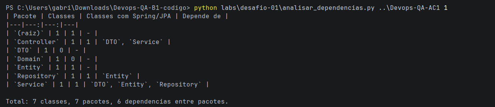

**Dependências depois (B1), por módulo e por subpacote**

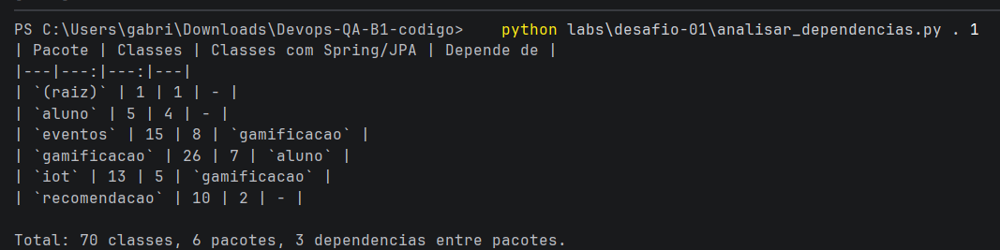

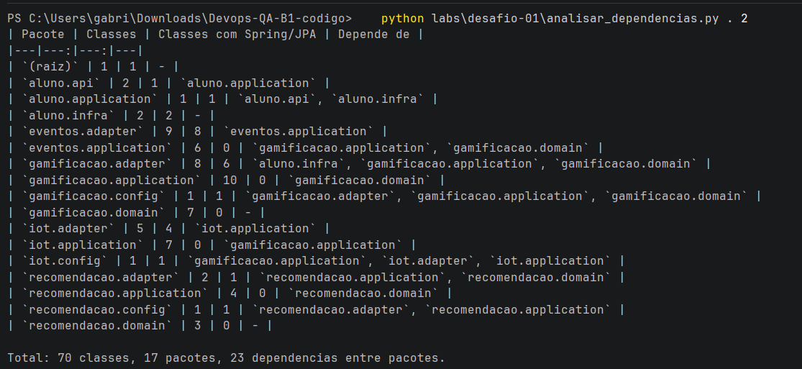

**Estrutura de módulos e regras de arquitetura**

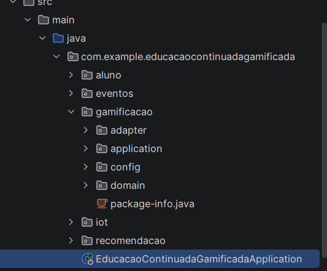

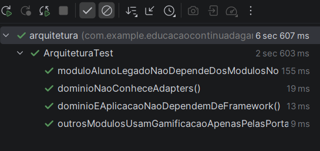

## 8. ADR + C4

### ADR-001: Evoluir o Core para Monólito Modular

- **Contexto:** crescimento para 100 mil usuários; ranking cresce mais; conquistas evoluem; Core da AC1 organizado por camada técnica, com a regra de negócio desconectada do fluxo.
- **ASRs/RPCs:** ASR-01, ASR-02, ASR-03; Java/Spring, 6 devs, legado da AC1.
- **Alternativas:** A. Camadas (mantém o acoplamento por tipo técnico); B. Monólito Modular; C. Serviço de ranking (complexidade distribuída sem ASR que justifique).
- **Decisão:** Monólito Modular por capacidade de negócio. Cada módulo expõe portas de entrada (`application.port.in`) como API pública. Ranking com consulta top N paginada e índice `idx_alunos_moedas`.
- **Consequências:**
  - (+) fronteiras explícitas e testadas; um deploy do Core; transação local para conclusão + recompensa.
  - (+) o módulo `gamificacao` já está isolado: extrair o ranking vira troca de adapter, não reescrita.
  - (-) tabela `alunos` compartilhada entre `aluno` e `gamificacao` (legado), conhecida apenas pelo `AlunoGamificacaoJpaAdapter`.
  - (-) uma réplica a mais escala o Core inteiro.
  - **Gatilho para reavaliar (C):** ranking com p95 acima de 300 ms mesmo com réplicas e índice, ou cadência de deploy própria para o ranking.

**C4 Container (após o Desafio 1).** A decisão é interna ao Core; a organização interna está no C4 Component do Desafio 2.

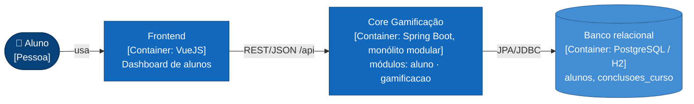

**Rastreabilidade:** RF01/RF02 → manutenibilidade, desempenho, complexidade operacional → ASR-01/02/03 + RPC → B vence A e C → ADR-001 → C4 Container → dependências antes/depois + ArchUnit.

---

# Desafio 2: Organização interna do Core

**Cenário:** regras de ranking, moedas, badges e recompensas mudam com frequência; domínio, banco, framework e integrações não podem ficar acoplados.

## 1. RF

RF01 Ranking; RF02 Conquistas e regras de gamificação.

## 2. RNF (FURPS+)

| RNF | FURPS+ |
|---|---|
| Manutenibilidade | S |
| Testabilidade | S |
| Modificabilidade | S |
| Facilidade de evolução | S |

## 3. ASR (máx. 3)

| ASR | Como altera a arquitetura |
|---|---|
| ASR-04 Modificabilidade | **Estrutura:** a regra fica no domínio, sem JPA/Spring; mudar regra não mexe em persistência |
| ASR-05 Testabilidade | **Estrutura/dependências:** persistência e eventos viram portas, trocáveis por adapters em memória |

Manutenibilidade e facilidade de evolução já estão cobertas por ASR-01 e ASR-04.

## 4. RPC

Core continua Spring Boot; regras existentes reaproveitadas; não reescrever o produto só para aplicar um padrão.

## 5. Decisão do Tech Lead

- **Qual dependência precisa ser invertida?** Persistência (o service dependia de `JpaRepository`) e publicação de eventos (que cresce com notificação, analytics e IoT). A transação também sai do domínio (`TransactionTemplate` na configuração).
- **O custo é proporcional?** Só no módulo `gamificacao`, onde as regras mudam. O CRUD `aluno` continua em camadas.
- **DDD, Hexagonal, Clean e Onion concorrem?** Não. Hexagonal, Clean e Onion aplicam a mesma regra de dependência para dentro; usamos a nomenclatura Hexagonal. DDD tático (entidade `Aluno`, serviço de domínio `Ranking`, evento `CursoConcluidoEvento`) dá o modelo que fica no centro.

## 6. Alternativas e trade-offs

| Critério | A. Camadas atuais | **B. Ports and Adapters na Gamificação** | C. Clean/Onion em todos os módulos |
|---|---|---|---|
| ASR-04 | Regra perto do JPA | **Regra isolada no domínio** | Regra isolada |
| ASR-05 | Teste exige Spring ou mock de repositório | **Teste com adapter em memória** | Teste com adapter em memória |
| Custo | Nenhum | **Médio, só onde há regra** | Alto, inclusive no CRUD sem regra |
| RPC "não reescrever" | Atende | **Atende (regra da AC1 preservada)** | Fere |

## 7. Mini-lab / evidência

- **Regra isolada:** `Aluno.concluirCurso` (moedas, cursos e badges) reaproveita `avaliarConclusaoCurso` da AC1 sem alterá-la; os 4 BDDs da AC1 continuam passando.
- **Testes do domínio:** 16 testes verdes em cerca de 160 ms, sem Spring e sem banco.
- **Adapter trocado:** o mesmo caso de uso rodou com o perfil `memoria` (adapters em memória) e com o perfil padrão (adapters JPA/H2), com **o mesmo resultado**: 201, 15 moedas, 3 cursos liberados, badges `PRIMEIRA_CONCLUSAO` e `EXCELENCIA`.
- **Idempotência:** reenvio da mesma conclusão retornou 200 com `jaRegistrada: true` e 0 moedas.
- **Ranking:** Gabrielle 15 (1º), Afonso 10 (2º), Giulianno 0 (3º).
- **Build completo:** `mvnw clean verify` com BUILD SUCCESS (34 testes, ArchUnit e gate JaCoCo).

**Build e testes de domínio**

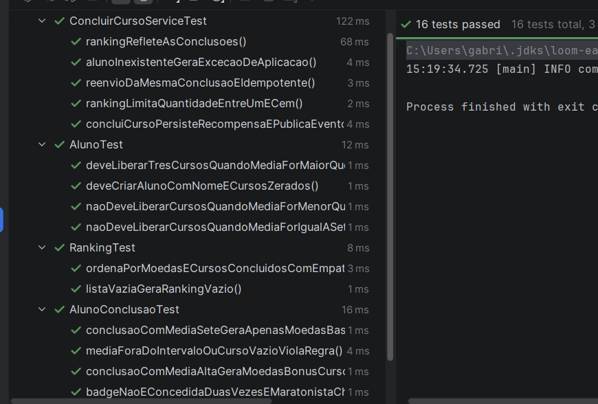

**Adapter em memória (perfil `memoria`)**

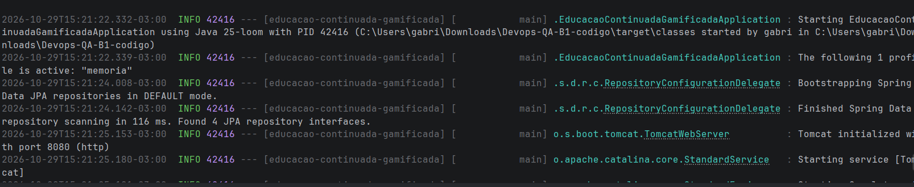

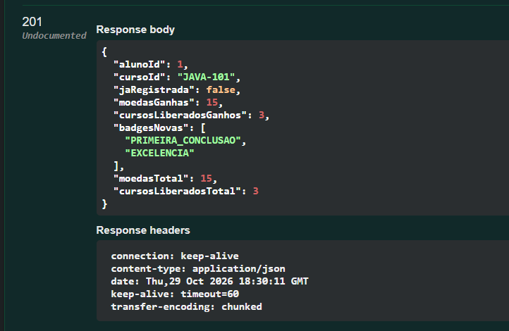

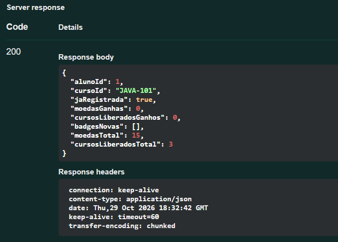

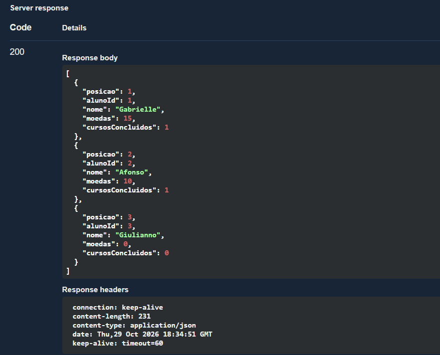

**Adapter JPA (perfil padrão, H2)**

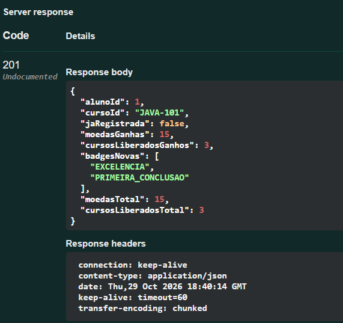

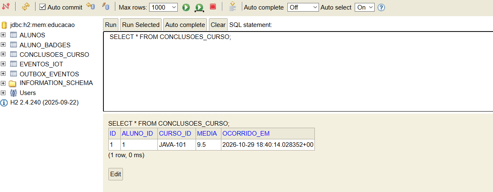

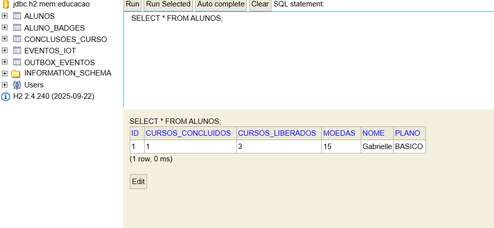

## 8. ADR + C4

### ADR-002: Ports and Adapters no módulo de Gamificação

- **Contexto:** regras mudam com frequência; na AC1 o service dependia direto do JPA e a regra era testável mas desconectada.
- **ASRs/RPCs:** ASR-04, ASR-05; Spring Boot mantido, regra da AC1 reaproveitada, sem reescrita.
- **Alternativas:** A. Camadas atuais; B. Ports and Adapters só na Gamificação; C. Clean/Onion em todos os módulos.
- **Decisão:** B, com DDD tático leve. Portas de saída `AlunoGamificacaoRepository`, `ConclusaoCursoRepository` e `EventoPublisher`; adapters JPA (padrão) e em memória (perfil `memoria`); transação no `GamificacaoConfig`. O módulo `aluno` permanece em camadas.
- **Consequências:**
  - (+) domínio e aplicação testáveis sem Spring; adapter trocável sem mudar regra.
  - (+) novas integrações (outbox, IoT) entram como adapters ou consumidores de portas.
  - (-) mapeamento domínio ↔ entidade JPA duplicado no adapter.
  - (-) dois estilos convivendo, documentados no `package-info.java` de cada módulo.

**C4 Component do Core**

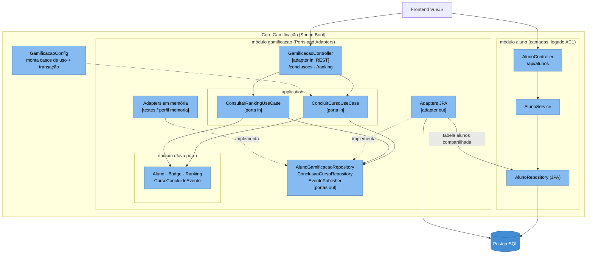

**Rastreabilidade:** RF01/RF02 → modificabilidade, testabilidade → ASR-04/05 + RPC → B vence A e C → ADR-002 → C4 Component → testes em memória + mesmo resultado em memória e JPA.

---

# Desafio 3: Serviço Python e IA

**Cenário:** recomendação inteligente e assistente educacional em Python, com ciclo próprio, carga variável e possibilidade de indisponibilidade sem impedir o Core.

## 1. RF

RF03 Recomendação inteligente; RF04 Assistente educacional.

## 2. RNF (FURPS+)

| RNF | FURPS+ |
|---|---|
| Deploy independente | S/+ |
| Escalabilidade | P |
| Tolerância a falhas | R |
| Interoperabilidade | F |
| Desempenho | P |
| Manutenibilidade | S |

## 3. ASR (máx. 3)

| ASR | Como altera a arquitetura |
|---|---|
| ASR-06 Tolerância a falhas | **Comunicação:** chamada com timeout curto (1,5 s) e fallback definido pelo Core |
| ASR-07 Deploy independente | **Implantação:** IA vira container e pipeline próprios |
| ASR-08 Escalabilidade | **Implantação:** réplicas da IA independentes das do Core |

Interoperabilidade é atendida por contrato REST/JSON simples; desempenho é limitado pelo timeout (parte do ASR-06).

## 4. RPC

Core permanece Java/Spring Boot; ML/RAG em Python; indisponibilidade da IA não pode bloquear o fluxo essencial.

## 5. Decisão do Tech Lead

- **Python por si só justifica um serviço?** Não, é só uma RPC de linguagem. O que justifica são ciclo de deploy, escala e falha diferentes (ASR-06/07/08).
- **ML e RAG precisam da mesma fronteira?** Hoje sim (mesma equipe e cadência), em módulos separados no serviço (`app/recomendacao.py`, `app/rag.py`). Separar quando o RAG usar LLM pesado (GPU, fila) ou a recomendação exigir treino batch próprio.
- **Comportamento degradado aceitável:** recomendação devolve o catálogo padrão com `degradado: true`; assistente responde "temporariamente indisponível". Conclusão, moedas e ranking não dependem da IA.

## 6. Alternativas e trade-offs

| Critério | A. IA embutida no Core | B. Módulo acoplado | **C. Serviço Python independente** |
|---|---|---|---|
| RPC Python | Fere | Atende com acoplamento de processo | **Atende** |
| ASR-06 Falha isolada | Não | Parcial | **Sim, timeout + fallback** |
| ASR-07 Deploy independente | Não | Não | **Sim** |
| ASR-08 Escala própria | Não | Não | **Sim** |
| Custo | Baixo | Médio | **Rede + 1 container + 1 pipeline** |

## 7. Mini-lab / evidência

Spring Boot (Core) consumindo o `ia-service` em FastAPI, com o serviço Python no ar, interrompido, lento e com erro.

| Situação do ia-service | Resposta do Core | Medida |
|---|---|---|
| No ar | 200, `degradado: false`, `origem: ia-service` (PY-201, SQL-101, ML-301) | |
| Parado (`docker compose stop`) | 200, `degradado: true`, `origem: fallback-core` | navegador: `ERR_CONNECTION_REFUSED` |
| Parado: conclusão de curso | **201**, 15 moedas (total 45) | fluxo essencial intacto |
| Parado: assistente | 200, `degradado: true`, mensagem amigável | |
| Lento (3 s por resposta) | 200, `degradado: true` | **1,51 s** (corte no timeout de 1,5 s) |
| 100% de erro 503 | 200, `degradado: true` | **0,023 s** |
| No ar: assistente (RAG) | 200, trecho da base `moedas-e-badges` | `degradado: false` |

Métrica do Core `ia_requisicoes_seconds_count` registrou sucesso e falha por operação (recomendação e assistente).

**ia-service no ar**

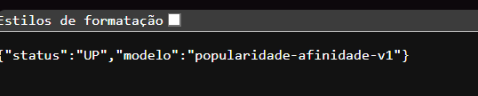

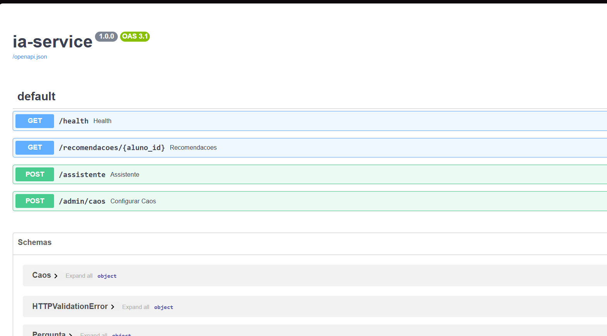

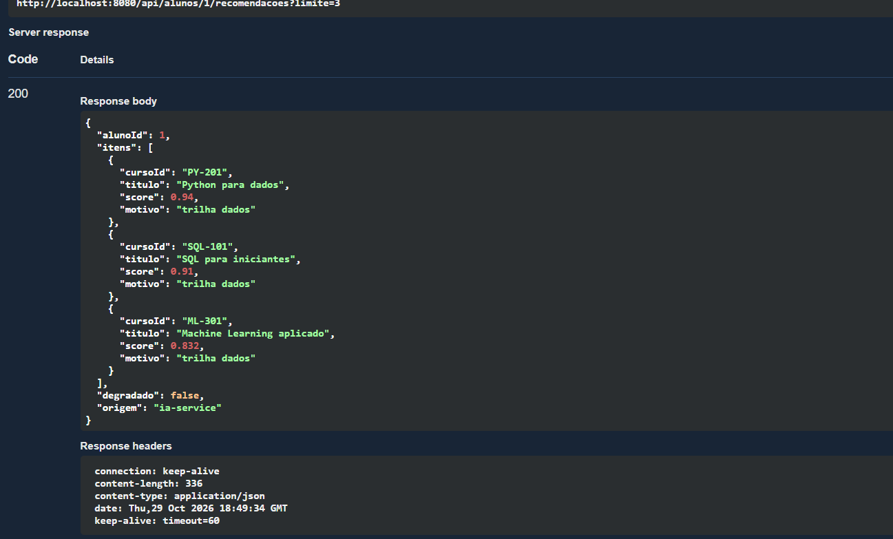

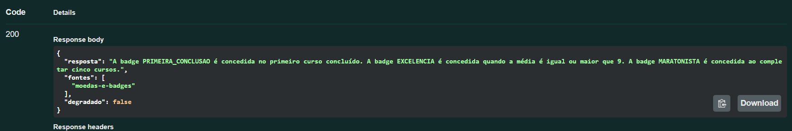

**ia-service interrompido**

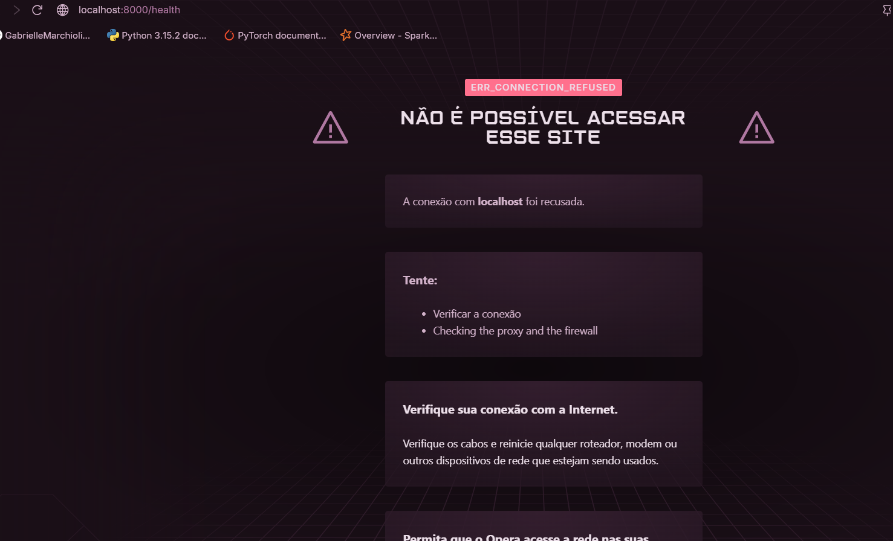

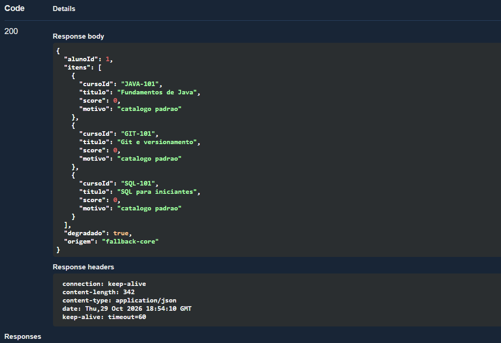

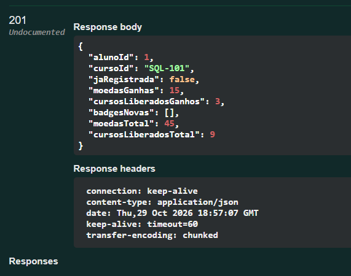

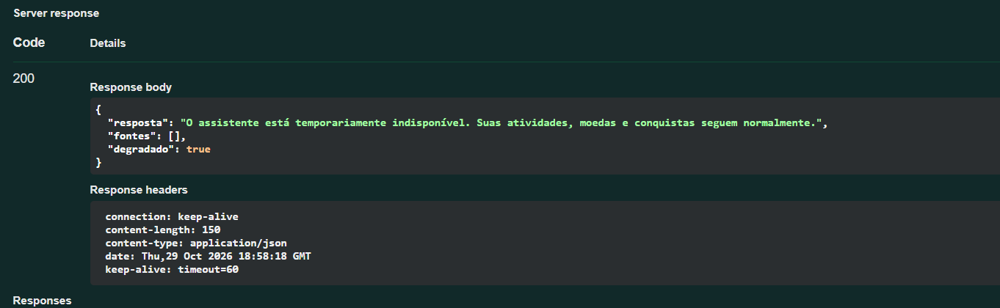

**ia-service lento e com erro**

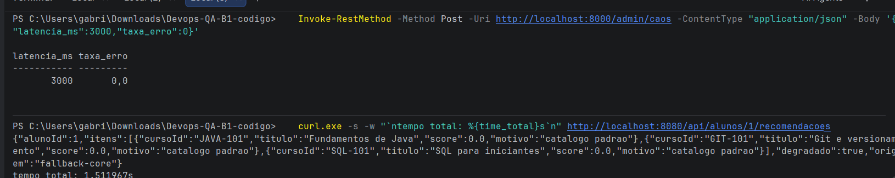

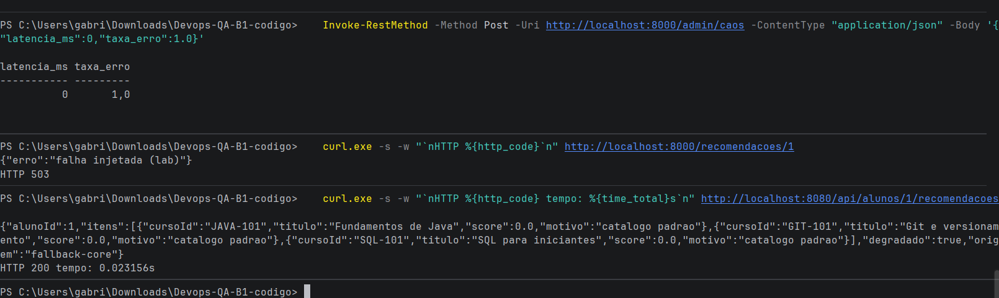

**Métricas da integração**

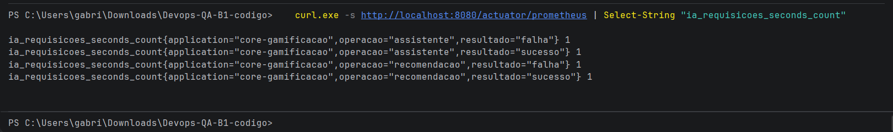

## 8. ADR + C4

### ADR-003: Serviço Python independente para IA (recomendação + RAG)

- **Contexto:** RF03/RF04 em Python, com ciclo de atualização próprio, carga variável e possibilidade de indisponibilidade.
- **ASRs/RPCs:** ASR-06, ASR-07, ASR-08; Core Java, IA Python, IA fora não bloqueia o Core.
- **Alternativas:** A. IA embutida no Core; B. módulo acoplado; C. serviço Python independente.
- **Decisão:** C. `ia-service` FastAPI com `GET /recomendacoes/{alunoId}` e `POST /assistente`; Core consome via portas `MotorRecomendacaoPort`/`AssistentePort` e adapter `IaHttpAdapter` (REST/JSON síncrono, timeout 1,5 s); comportamento degradado no `RecomendacaoService`. ML e RAG juntos, em módulos separados.
- **Consequências:**
  - (+) modelo trocável sem tocar no Core; falha observável por métrica.
  - (-) mais um container e um pipeline (ADR-006).
  - (-) no lab, modelo baseline (popularidade + afinidade) e RAG extrativo; ponto de extensão para LLM em `rag.gerar_resposta()`.
  - Próximo passo: circuit breaker se o volume crescer.

**C4 Container com a fronteira da IA**

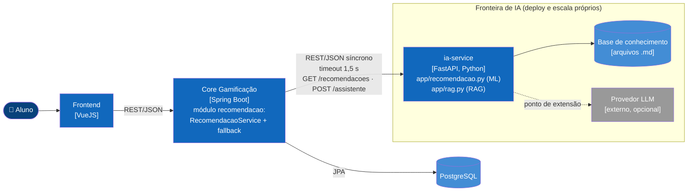

**Rastreabilidade:** RF03/RF04 → tolerância a falhas, deploy independente, escalabilidade → ASR-06/07/08 + RPC → C vence A e B → ADR-003 → C4 Container → IA parada, lenta e com 503 sem afetar o Core.

---

# Desafio 4: Comunicação e eventos

**Cenário:** concluir curso registra a conclusão, calcula recompensas, atualiza informações e pode disparar notificação/analytics. Falha de notificação não pode impedir a conclusão.

## 1. RF

RF02 Conquistas; RF05 Notificações; eventos de conclusão de atividade.

## 2. RNF (FURPS+)

| RNF | FURPS+ |
|---|---|
| Tolerância a falhas | R |
| Disponibilidade | R |
| Latência | P |
| Consistência | R |
| Desacoplamento | S |
| Recuperabilidade | R |

## 3. ASR (máx. 3)

| ASR | Como altera a arquitetura |
|---|---|
| ASR-09 Disponibilidade do fluxo essencial | **Comunicação:** notificação e analytics saem do caminho síncrono |
| ASR-10 Consistência | **Dados:** evento gravado na mesma transação da conclusão (tabela outbox) |
| ASR-11 Recuperabilidade | **Operação:** fila durável, retentativa, DLQ e consumidores idempotentes |

## 4. RPC

Operações essenciais do Core concluem mesmo com consumidor externo indisponível; broker tem custo operacional.

## 5. Decisão do Tech Lead

- **Imediato:** registrar conclusão, moedas, cursos liberados e badges (resposta 201 ao aluno).
- **Eventual:** notificação e analytics.
- **ASR que justifica mensageria:** ASR-09 e ASR-11; sem fila durável, um consumidor fora perde ou bloqueia eventos.
- **RabbitMQ/Kafka resolvem um problema real?** RabbitMQ sim: filas de trabalho por consumidor, ack individual e DLQ. Kafka resolveria retenção e replay de stream, que o case não pede.

## 6. Alternativas e trade-offs

| Critério | REST síncrono | Eventos em memória | Publicar direto no broker | **Outbox + RabbitMQ** | Outbox + Kafka |
|---|---|---|---|---|---|
| ASR-09 | Não | Sim | Sim | **Sim** | Sim |
| ASR-10 (sem perda) | n/a | Não (JVM cai, perde) | Não (dual-write) | **Sim** | Sim |
| ASR-11 (reentrega/DLQ) | Não | Não | Parcial | **Sim** | Sim (replay) |
| Custo operacional | Baixo | Baixo | Médio | **Médio** | Alto |

## 7. Mini-lab / evidência

**Síncrono:** `POST /api/alunos/{id}/conclusoes` devolve as recompensas na hora.
**Assíncrono:** outbox → relay (a cada 5 s) → RabbitMQ → `notificacao-worker`.

| Cenário | Resultado |
|---|---|
| Sem broker (perfil padrão) | Evento gravado no outbox com o **mesmo instante** da conclusão (18:40:14.028352) e enviado 4 s depois |
| Worker desligado, 3 conclusões | 3 respostas 201; filas `notificacoes` e `analytics` com **3** mensagens retidas |
| Worker religado | 3 notificações enviadas; `notificacoes` = 0; `analytics` continua 3 (consumidor independente) |
| Mensagem malformada | Worker rejeita e manda para a DLQ (`gamificacao.eventos.dlq` = 1) |
| Broker parado: conclusão ML-301 | **201**, 15 moedas (total 60); relay registra "1 evento(s) nao entregues, permanecem PENDENTE" |
| Broker parado por mais de 50 s | Evento vai para `FALHA_DEFINITIVA` após **10 tentativas**, com `Connection refused` registrado |
| Broker volta em menos de 50 s: conclusão DOCKER-201 | `ENVIADO` na **5ª tentativa**, cerca de 24 s depois, sem ação manual |
| Worker caiu com o broker fora e foi corrigido | Ao religar, consumiu a notificação do DOCKER-201 que estava na fila durável |
| Métricas | `outbox_entregas_total{falha}` = 14, `{sucesso}` = 4, `outbox_eventos_pendentes` = 0 |

**Outbox na mesma transação**

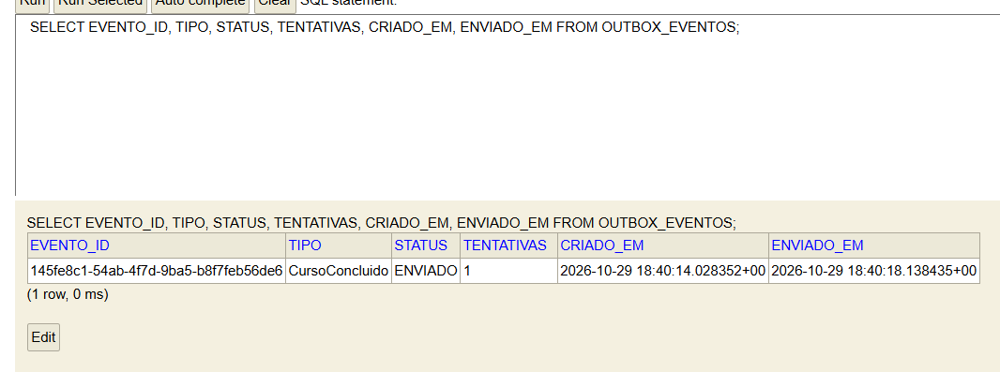

**RabbitMQ e consumidor indisponível**

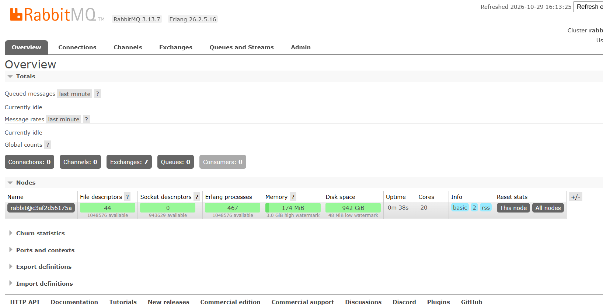

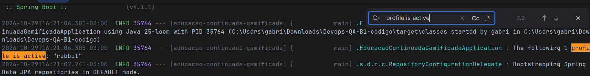

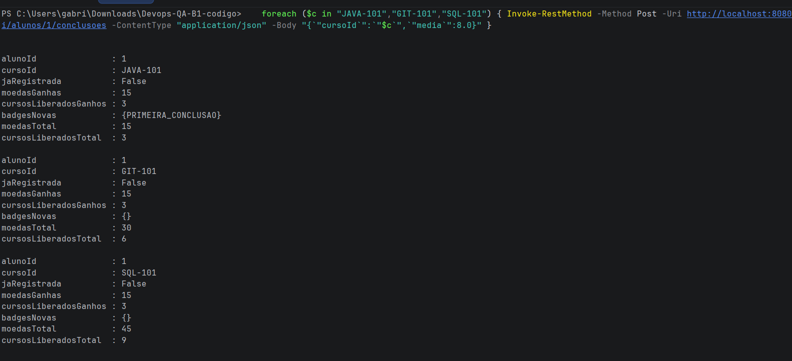

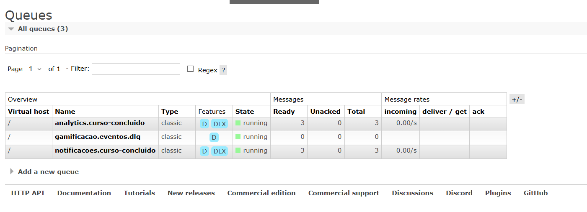

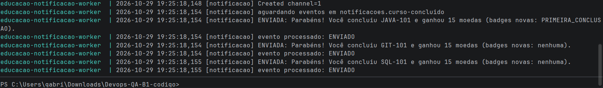

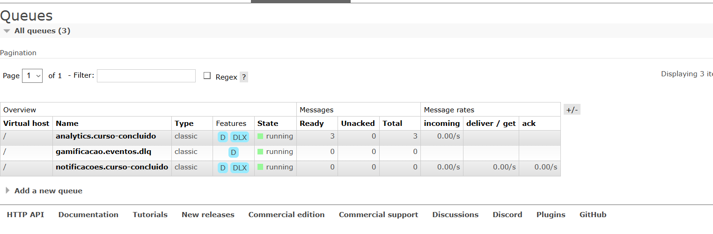

**DLQ**

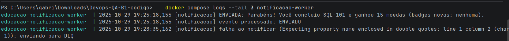

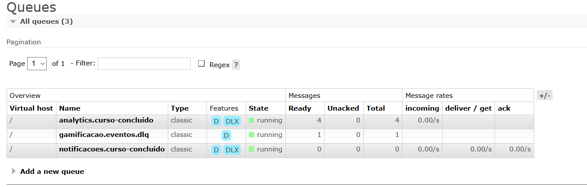

**Broker indisponível e recuperação**

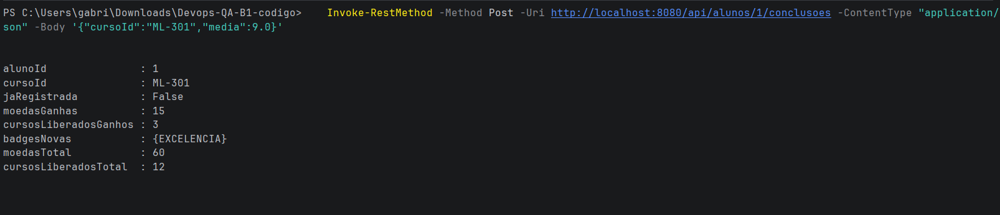

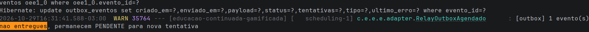

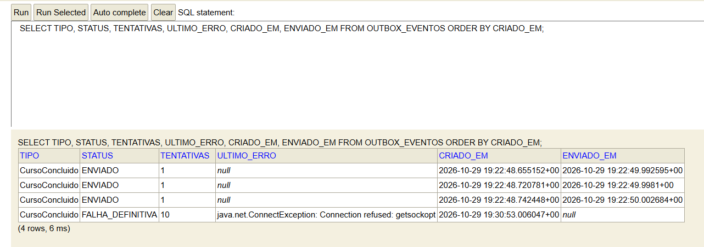

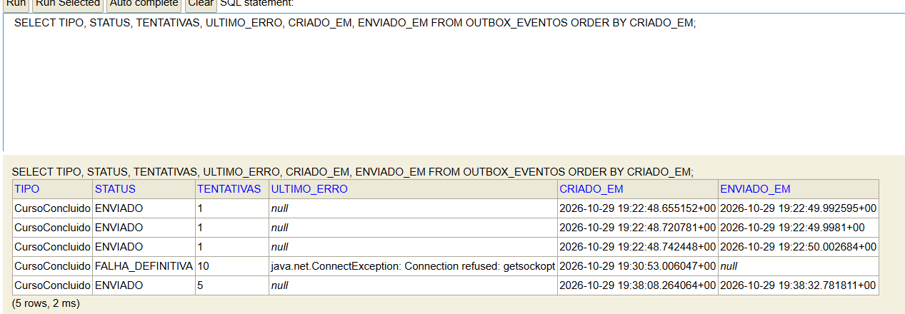

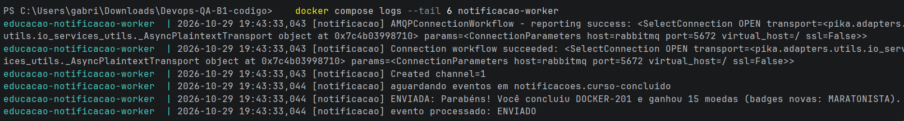

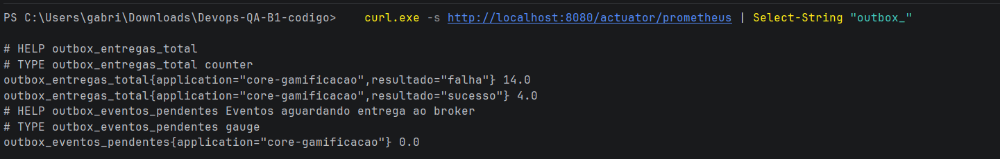

## 8. ADR + C4

### ADR-004: Conclusão síncrona + eventos assíncronos via Transactional Outbox e RabbitMQ

- **Contexto:** falha de notificação não pode impedir a conclusão; evento não pode se perder.
- **ASRs/RPCs:** ASR-09, ASR-10, ASR-11; Core conclui sem consumidor; broker tem custo.
- **Alternativas:** REST síncrono; eventos em memória; publicar direto no broker (dual-write); Outbox + RabbitMQ; Outbox + Kafka.
- **Decisão:** Outbox + RabbitMQ. `OutboxEventoPublisher` grava na mesma transação; `RelayOutboxAgendado` entrega a cada 5 s com retentativa; perfil `rabbit` com exchange topic `gamificacao.eventos`, filas duráveis por consumidor e DLQ; `notificacao-worker` deduplica por `eventoId`.
- **Consequências:**
  - (+) broker ou consumidor fora não afeta a conclusão; eventos retidos e entregues depois.
  - (+) acúmulo visível em `outbox_eventos_pendentes`.
  - (-) consistência eventual para notificação/analytics; consumidores idempotentes.
  - (-) o limite atual (10 tentativas a cada 5 s) leva um evento a `FALHA_DEFINITIVA` em cerca de 50 s de broker fora, exigindo reprocessamento manual. Para produção: backoff exponencial ou mais tentativas (`outbox.relay.max-tentativas`).
  - (-) tabela de outbox cresce; limpeza periódica de `ENVIADO`.

**C4 Container**

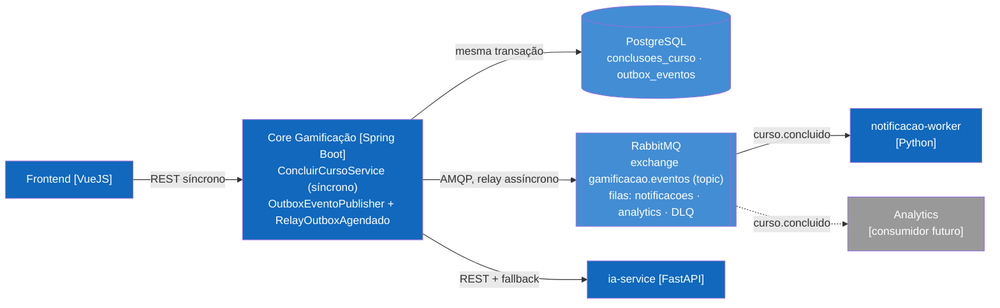

**Sequência do fluxo crítico**

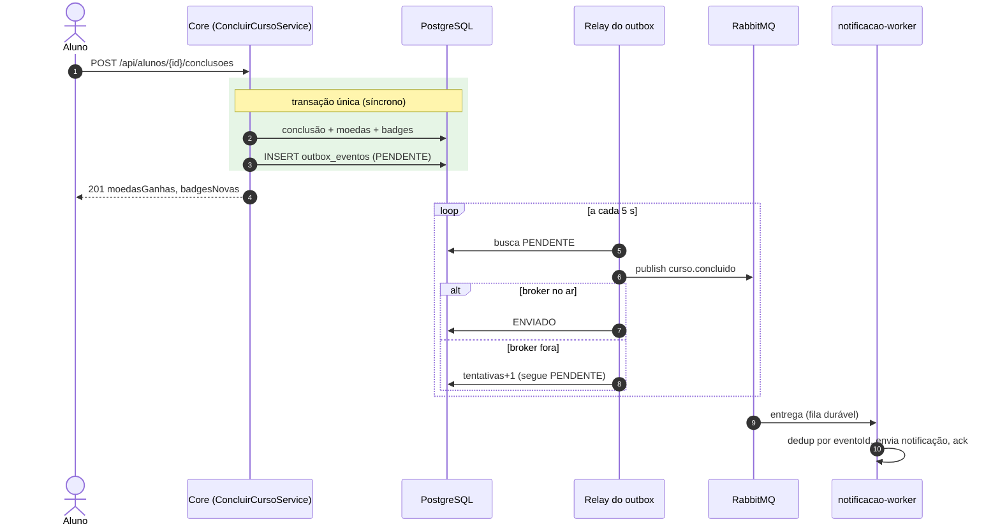

**Rastreabilidade:** RF02/RF05 → disponibilidade, consistência, recuperabilidade → ASR-09/10/11 + RPC → Outbox + RabbitMQ vence as outras opções → ADR-004 → C4 + sequência → consumidor e broker indisponíveis sem perda de conclusão nem de evento.

---

# Desafio 5: IoT e MQTT

**Cenário:** laboratórios geram eventos de presença, início e conclusão a partir de dispositivos limitados e com conexão instável, sem acoplar o Core a cada dispositivo.

## 1. RF

RF06 Receber eventos IoT e encaminhá-los ao ecossistema da plataforma.

## 2. RNF (FURPS+)

| RNF | FURPS+ |
|---|---|
| Interoperabilidade | F |
| Eficiência de comunicação | P |
| Disponibilidade | R |
| Tolerância à conectividade intermitente | R |
| Escalabilidade | P |
| Segurança de integração | F |

## 3. ASR (máx. 3)

| ASR | Como altera a arquitetura |
|---|---|
| ASR-12 Conectividade intermitente | **Comunicação:** broker com QoS 1, sessão persistente e ACK só após o Core aceitar |
| ASR-13 Eficiência de comunicação | **Protocolo:** MQTT com payload compacto em vez de HTTP por evento |
| ASR-14 Interoperabilidade | **Estrutura:** gateway traduz o formato do dispositivo; Core recebe contrato único |

Segurança de integração não muda a estrutura agora: entra como configuração do broker (TLS 8883 + credencial por dispositivo) na PoC.

## 4. RPC

Dispositivos com baixo poder computacional; conectividade intermitente; protocolo e broker adicionam componentes operacionais.

## 5. Decisão do Tech Lead

- **REST é suficiente?** Não: cada dispositivo teria que manter HTTP/TLS, retentativa e fila local, e o Core conheceria cada formato.
- **O que o MQTT resolve:** conexão leve e persistente, QoS 1 com sessão persistente e desacoplamento por tópico.
- **Outro broker depois do MQTT?** Não agora. Só o Core consome os eventos IoT, e o Core já distribui o que interessa via outbox/RabbitMQ (ADR-004).
- **Duplicidade e perda:** perda tratada por QoS 1 + sessão persistente + ACK manual; duplicidade tratada por deduplicação no gateway e idempotência no Core (`eventoId` como PK).

## 6. Alternativas e trade-offs

| Critério | A. REST direto | **B. MQTT + consumidor** | C. MQTT + mensageria interna |
|---|---|---|---|
| ASR-12 | Retentativa no dispositivo | **QoS 1 + sessão persistente** | Igual a B |
| ASR-13 | HTTP pesado | **MQTT leve** | Igual a B |
| ASR-14 | Core acoplado | **Gateway traduz** | Gateway traduz |
| Componentes novos | 0 | **2 (Mosquitto, gateway)** | 3 ou mais |
| ASR que justifica | n/a | **Todos acima** | Nenhum no case atual |

## 7. Mini-lab / evidência

Simulador de dispositivo publica no Mosquitto; o `iot-gateway` consome, valida, deduplica, transforma e chama o Core.

| Cenário | Resultado |
|---|---|
| Tudo no ar (`--duplicar`) | 5 publicações; 3 encaminhadas (202), 1 duplicada ignorada (mesmo id), 1 inválida descartada |
| No Core | `EVENTOS_IOT` com 3 linhas; aluno com **90 moedas** e **6 cursos concluídos** (a conclusão IoT contou uma vez só) |
| Gateway desligado durante a publicação | Mosquitto guardou os **6** eventos; ao religar, todos encaminhados em cerca de 125 ms |
| Core desligado | Gateway tentou 3 vezes cada evento e **não confirmou** (sem PUBACK) |
| Core religado | Mosquitto **reentregou os 3 eventos com os mesmos ids**, todos aceitos (202) |
| Métrica | `iot_gateway_eventos_total{resultado="ENCAMINHADO"}` |

**Fluxo normal, duplicado e inválido**

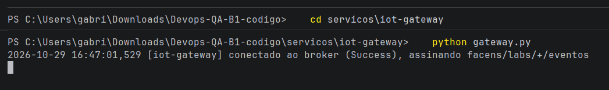

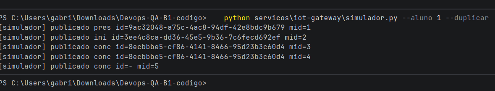

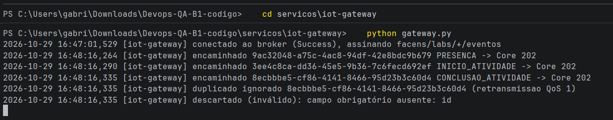

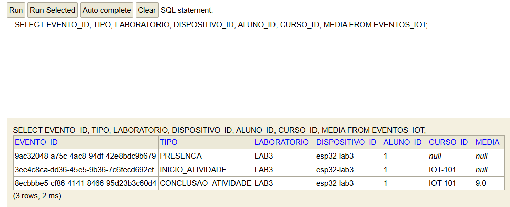

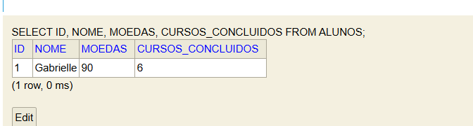

**Gateway fora do ar**

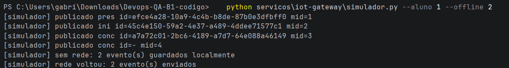


**Core fora do ar**


## 8. ADR + C4

### ADR-005: MQTT (Mosquitto) + iot-gateway para eventos de laboratório

- **Contexto:** dispositivos limitados e conexão instável; Core não pode acoplar a cada dispositivo.
- **ASRs/RPCs:** ASR-12, ASR-13, ASR-14; hardware limitado, rede instável, broker com custo.
- **Alternativas:** A. REST direto; B. MQTT + consumidor; C. MQTT + mensageria interna.
- **Decisão:** B. Mosquitto, tópico `facens/labs/{laboratorio}/eventos`, QoS 1; `iot-gateway` com sessão persistente e ACK manual após o Core aceitar; deduplicação no gateway e idempotência no Core; conclusão via IoT reaproveita `ConcluirCursoUseCase`.
- **Consequências:**
  - (+) gateway ou Core fora não perdem evento QoS 1.
  - (+) Core recebe um contrato único, independente de fabricante.
  - (-) Mosquitto e gateway entram no deploy e no monitoramento.
  - (-) a deduplicação do gateway fica em memória e zera ao reiniciar; a garantia final é a PK `eventoId` no Core.
  - Pendente para produção: TLS (8883) e autenticação por dispositivo.

**C4 Container**


**Rastreabilidade:** RF06 → intermitência, eficiência, interoperabilidade → ASR-12/13/14 + RPC → B vence A e C → ADR-005 → C4 com dispositivos, broker, gateway e Core → gateway e Core indisponíveis sem perda nem duplicação.

---

# Desafio 6: CI/CD e observabilidade

**Cenário:** a solução tem Core Java, serviços Python, brokers e integrações; precisa ser testada, implantada e observada com segurança.

## 1. RF

Todos os RFs impactados (RF01 a RF06); operação e evolução da solução.

## 2. RNF (FURPS+)

| RNF | FURPS+ |
|---|---|
| Observabilidade | S/+ |
| Deploy independente | S/+ |
| Confiabilidade | R |
| Testabilidade | S |
| Recuperabilidade | R |
| Desempenho | P |

## 3. ASR (máx. 3)

| ASR | Como altera a arquitetura |
|---|---|
| ASR-15 Deploy independente | **Implantação:** um pipeline e uma imagem por componente |
| ASR-16 Confiabilidade da entrega | **Operação:** gates automáticos que bloqueiam deploy |
| ASR-17 Observabilidade | **Operação:** métricas ligadas a ASRs, com alertas versionados |

## 4. RPC

Jenkins na esteira; Prometheus/Grafana no laboratório; artefatos e configurações versionados (`Jenkinsfile`, `servicos/*/Jenkinsfile`, `jenkins/Dockerfile`, `observabilidade/`).

## 5. Decisão do Tech Lead

- **Serviços independentes exigem pipelines independentes?** Sim, senão o deploy independente do ADR-003 não existe na prática.
- **O que bloqueia deploy:** testes, `ArquiteturaTest` (ArchUnit), cobertura JaCoCo abaixo de 80% em domain/application, falha no build da imagem e smoke test.
- **Métricas que validam ASRs anteriores:**

| ASR validado | Métrica | Alerta |
|---|---|---|
| ASR-06 IA não bloqueia | `ia_requisicoes_total{status}`, `ia_latencia_segundos`, `ia_requisicoes_seconds_count{resultado}` | `IaServiceDegradado`, `CoreUsandoFallbackDeIa` |
| ASR-09/11 Eventos | `outbox_eventos_pendentes`, `outbox_entregas_total{resultado}` | `OutboxAcumulando` |
| ASR-02/09 Fluxo essencial | `http_server_requests_seconds{uri="/api/alunos/{alunoId}/conclusoes"}` | `LatenciaConclusaoCursoAlta` |
| ASR-12 IoT | `iot_gateway_eventos_total{resultado}` | painel |

- **Métrica técnica x evidência arquitetural:** métrica técnica (CPU, heap) diz como a máquina está; evidência arquitetural é uma métrica ligada a um ASR com limite e alerta. Exemplo: taxa de 503 da IA acima de 20% sem queda do Core comprova o ASR-06.

## 6. Alternativas e trade-offs

| Critério | Pipeline único | **Pipeline por componente** |
|---|---|---|
| ASR-15 | Não: tudo reconstrói junto | **Sim** |
| Isolamento de falha na esteira | Teste Python quebra o deploy do Core | **Isolado** |
| Manutenção | 1 Jenkinsfile | **Um por componente (candidato a shared library)** |

## 7. Mini-lab / evidência

**Observabilidade (falha provocada no ia-service):**

| Fase | Resultado |
|---|---|
| Alvos | Prometheus com 3 alvos UP: `core-gamificacao`, `ia-service`, `iot-gateway` |
| Normal | Cerca de 15 req/s com status 200; latência p95 perto de 0; 4 alertas INACTIVE |
| Falha (60% de 503 + 600 ms) | Linha de 503 acima da de 200; p95 perto de 1 s; Core registrando `falha` |
| Alerta | `IaServiceDegradado` **FIRING** por quase 4 min, valor **0,56** |
| Recuperação | 200 de volta a cerca de 14 req/s; 503 em zero; alerta **INACTIVE** |

**Jenkins (pipelines por componente e gates):**

| Build | Resultado |
|---|---|
| `core-gamificacao` #2 | Verde: Checkout, Testes (34 testes), Quality gate, Imagem Docker; Deploy e Smoke pulados (só rodam em homologação) |
| `core-gamificacao` #3 | **Bloqueado:** violação proposital (Spring no domínio) derrubou o `ArquiteturaTest` em `Ranking.java:23`; Imagem, Deploy e Smoke não rodaram |
| `core-gamificacao` #4 | Verde após `git revert` |
| `ia-service` #1 | Verde: pytest + Imagem Docker, pipeline próprio (27 s) |

**Prometheus e Grafana**


**Jenkins: pipeline do Core verde**


**Jenkins: gate bloqueando o deploy**


**Jenkins: pipelines por componente**


## 8. ADR + C4

### ADR-006: Pipelines Jenkins por componente e observabilidade orientada a ASR

- **Contexto:** solução com Core Java, ia-service, iot-gateway, notificacao-worker, RabbitMQ e Mosquitto.
- **ASRs/RPCs:** ASR-15, ASR-16, ASR-17; Jenkins, Prometheus/Grafana, configuração versionada.
- **Alternativas:** pipeline único; pipeline por componente.
- **Decisão:** um Jenkinsfile por componente (`Jenkinsfile` do Core e `servicos/*/Jenkinsfile`); gates de testes, ArchUnit, JaCoCo, imagem e smoke; métricas Micrometer/Prometheus em cada componente; alertas em `observabilidade/prometheus/alertas.yml`; dashboard provisionado em `observabilidade/grafana`.
- **Consequências:**
  - (+) falha da IA aparece como alerta de degradação, não como indisponibilidade do produto.
  - (+) regra de arquitetura vira gate de entrega (build #3).
  - (-) um pipeline por componente para manter.
  - (-) no lab o Jenkins roda em container (`jenkins/Dockerfile`, porta 8081) em job Pipeline simples; Deploy e Smoke só executam em job multibranch na `main`.

**C4 Deployment**


**Rastreabilidade:** RF01 a RF06 → observabilidade, deploy independente, confiabilidade → ASR-15/16/17 + RPC → pipeline por componente vence pipeline único → ADR-006 → C4 Deployment → alerta disparado e resolvido + deploy bloqueado pelo ArchUnit.

---

# C4 final


# Achados dos labs

Os testes de falha revelaram pontos que viraram ajustes ou trade-offs registrados:

| Achado | Desafio | Tratamento |
|---|---|---|
| O `notificacao-worker` caiu com `socket.gaierror` quando o container do RabbitMQ parou (só tratava `AMQPConnectionError`) | 4 | Corrigido: passa a tratar `AMQPError` e `OSError` e reconectar; `restart: unless-stopped` no compose |
| Com 10 tentativas a cada 5 s, um evento vai para `FALHA_DEFINITIVA` em cerca de 50 s de broker fora | 4 | Registrado no ADR-004; para produção, backoff ou mais tentativas |
| Imagem padrão do Jenkins sem o cliente Docker (`docker: not found`) | 6 | `jenkins/Dockerfile` copia o cliente Docker da imagem oficial |
| No lab, Core e gateway rodaram fora do Docker; o Prometheus coleta via `host.docker.internal` | 6 | No ambiente 100% Docker, voltar os alvos para `app:8080` e `iot-gateway:9102` |

# Como executar

```powershell
# build, testes, ArchUnit e JaCoCo
.\mvnw.cmd clean verify

# Core local (perfis: padrao/H2, memoria, rabbit, postgres)
.\mvnw.cmd spring-boot:run "-Dspring-boot.run.profiles=rabbit"

# servicos de apoio
docker compose up -d ia-service rabbitmq notificacao-worker mosquitto prometheus grafana

# iot-gateway e simulador
python servicos\iot-gateway\gateway.py
python servicos\iot-gateway\simulador.py --aluno 1 --duplicar

# Jenkins do laboratorio (porta 8081)
docker build -t jenkins-b1 jenkins
docker run -d --name jenkins-b1 -u root -p 8081:8080 -v jenkins_b1_home:/var/jenkins_home -v /var/run/docker.sock:/var/run/docker.sock jenkins-b1
```

| Serviço | Endereço |
|---|---|
| Core (Swagger) | http://localhost:8080/swagger-ui/index.html |
| ia-service | http://localhost:8000/docs |
| RabbitMQ | http://localhost:15672 (guest/guest) |
| Prometheus | http://localhost:9090 |
| Grafana | http://localhost:3000 (admin/admin) |
| Jenkins | http://localhost:8081 |

| Novos endpoints do Core | Desafio |
|---|---|
| `POST /api/alunos/{alunoId}/conclusoes` | 2, 4 |
| `GET /api/ranking?limite=10` | 1, 2 |
| `GET /api/alunos/{alunoId}/recomendacoes` | 3 |
| `POST /api/assistente` | 3 |
| `POST /api/iot/eventos` (usado pelo iot-gateway) | 5 |
| `GET /actuator/prometheus` | 6 |

# Síntese final: o que vai para a PoC da AF

| Decisão | Vai para a AF? | Como |
|---|---|---|
| ADR-001 Monólito Modular | **Sim** | Base do Core; ranking no monólito até o gatilho de p95 > 300 ms |
| ADR-002 Hexagonal na Gamificação | **Sim** | Novas regras (recompensas, desafios semanais) entram só no domínio |
| ADR-003 ia-service | **Sim** | Trocar o RAG extrativo por LLM em `gerar_resposta()`; avaliar circuit breaker |
| ADR-004 Outbox + RabbitMQ | **Sim** | Backoff no relay; consumidor de analytics; limpeza do outbox |
| ADR-005 MQTT + gateway | **Sim, com segurança** | TLS 8883 e credencial por dispositivo |
| ADR-006 Pipelines + observabilidade | **Sim** | Job multibranch com deploy em homologação; shared library para os pipelines Python |

Fluxo da PoC: dispositivo conclui atividade (MQTT) → gateway → Core registra conclusão e moedas → ranking atualizado → evento no RabbitMQ → notificação → recomendação da IA na tela (e fallback ao derrubar o ia-service) → tudo visível no Grafana.
